<div align="center">

# ✍️ Lemma Notes AI

### An iPad notebook that writes the answer back **in your own handwriting**

Circle a question. Tap **Ask**. The answer appears on the page, drawn from *your* strokes.

<br>


<br>

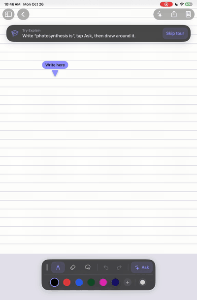

<sub>Real iPad recording: write it, circle it, tap Ask. The answer is drawn back in the writer's own hand.</sub>

<br><br>

[**What it does**](#-what-it-does) ·
[**Demo**](#-demo) ·
[**Screenshots**](#-screenshots) ·
[**How it works**](#-how-it-works) ·
[**Engineering**](#-engineering-at-a-glance) ·
[**Run it**](#-build-and-run) ·
[**Roadmap**](#-status-and-roadmap)

</div>

---

## ✨ What it does

Most note apps put AI in a sidebar: you ask, then copy the answer back into your notes. Lemma Notes AI puts the answer **on the page**, as ink, in your handwriting, right below your question.

<table>
<tr>
<td width="33%" valign="top">

### 🧮 Solve
Write an equation, circle it, and the working comes back line by line, in your hand.

</td>
<td width="33%" valign="top">

### 💬 Explain
Circle a question, a half-finished sentence or a term. Get a short prose answer, a definition, or the sentence finished.

</td>
<td width="33%" valign="top">

### 📈 Plot
Circle `y = x³ + cos(x)` and a hand-drawn graph appears with labelled axes. The model reads the formula; the app draws the curve itself.

</td>
</tr>
</table>

Everything else is a real notebook, not a demo:

- **Handwriting that is actually yours.** A short calibration teaches the app your characters, and it keeps learning from what you write (up to ~20 variants per character, never from its own output). Each answer picks variants at random, so no two letters look stamped.
- **A Notability-class canvas.** Apple Pencil input through PencilKit, lasso, eraser, undo/redo, 16 pen colours, four pen widths, Pencil double-tap to switch pen/eraser, edge-to-edge pages that fit the screen.
- **A tool board you can dock anywhere.** Drag it by its grip to any edge; on the sides it stands up as two columns.
- **Library.** Folders, favourites, recents, a title search, preview-card grid, templates (blank, lined, grid, dots) and paper sizes (Tablet, Letter, A4, Square), day-named notes, PDF/PNG export.
- **Ghost answers.** Every answer lands as a preview you can drag, resize, **Keep** or **Discard**. Nothing touches your page until you say so.
- **A guided first run.** An interactive tour that has you write, circle and ask for real, with bouncing arrows pointing at what to do next.
- **A business behind it.** Free notebook, Premium AI (StoreKit 2 subscriptions, 3-day trial), and a server that verifies purchases and devices so the AI can't be abused.

---

## 🎬 Demo

<div align="center">

<a href="docs/media/demo.mp4">
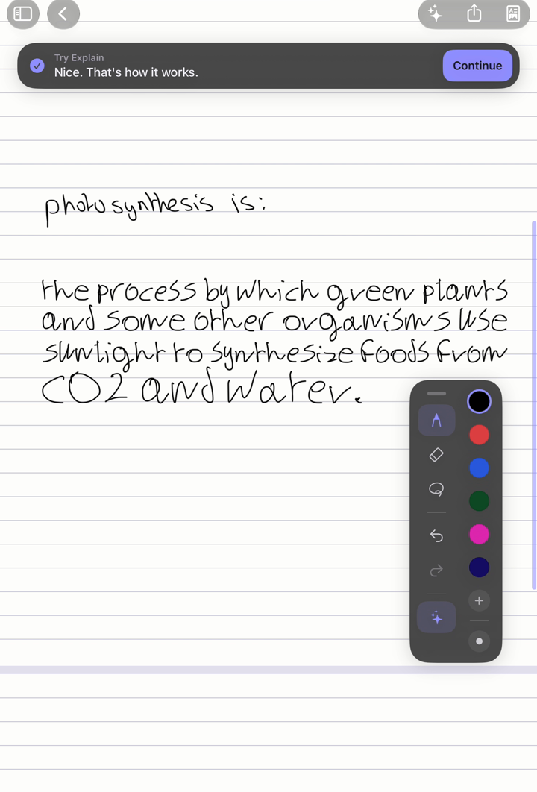
</a>

**[▶ Watch the 2-minute walkthrough (MP4)](docs/media/demo.mp4)**

<sub>Recorded on an iPad mini: the guided first run, teaching it a handwriting, then Explain, Solve and Plot on a fresh note.</sub>

</div>

<details>
<summary><b>Also: the in-app intro animation</b></summary>

<div align="center">
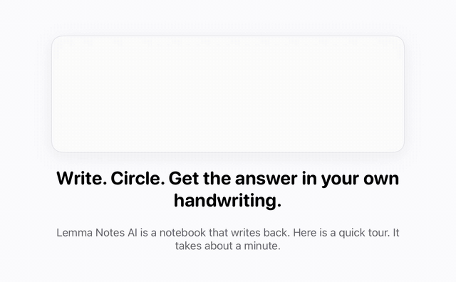
</div>

</details>

---

## 📸 Screenshots

### Your handwriting, written back

Real captures from an iPad mini. The answers below were generated by the app, not drawn by hand:

<table>
<tr>
<td width="50%">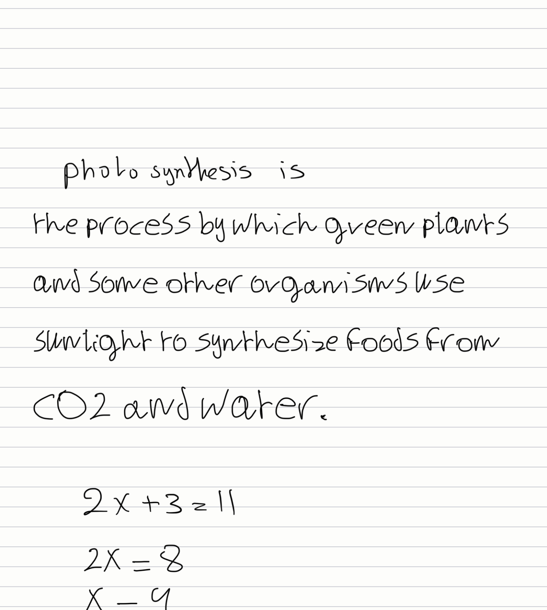</td>
<td width="50%">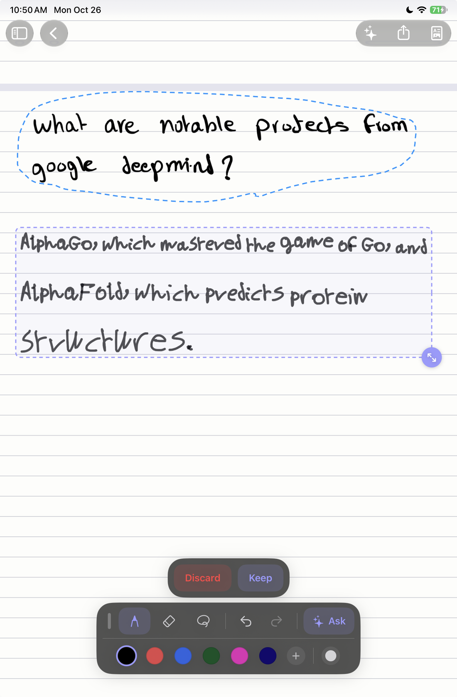</td>
</tr>
<tr>
<td align="center"><sub><b>Explain + Solve.</b> "photosynthesis is…" is finished in the writer's own hand, and <code>2x + 3 = 11</code> is solved line by line.</sub></td>
<td align="center"><sub><b>Ask about anything you wrote.</b> The dashed outline is the lasso; the answer appears as a ghost you can drag, resize and keep.</sub></td>
</tr>
</table>

### The app

<table>
<tr>
<td width="33%">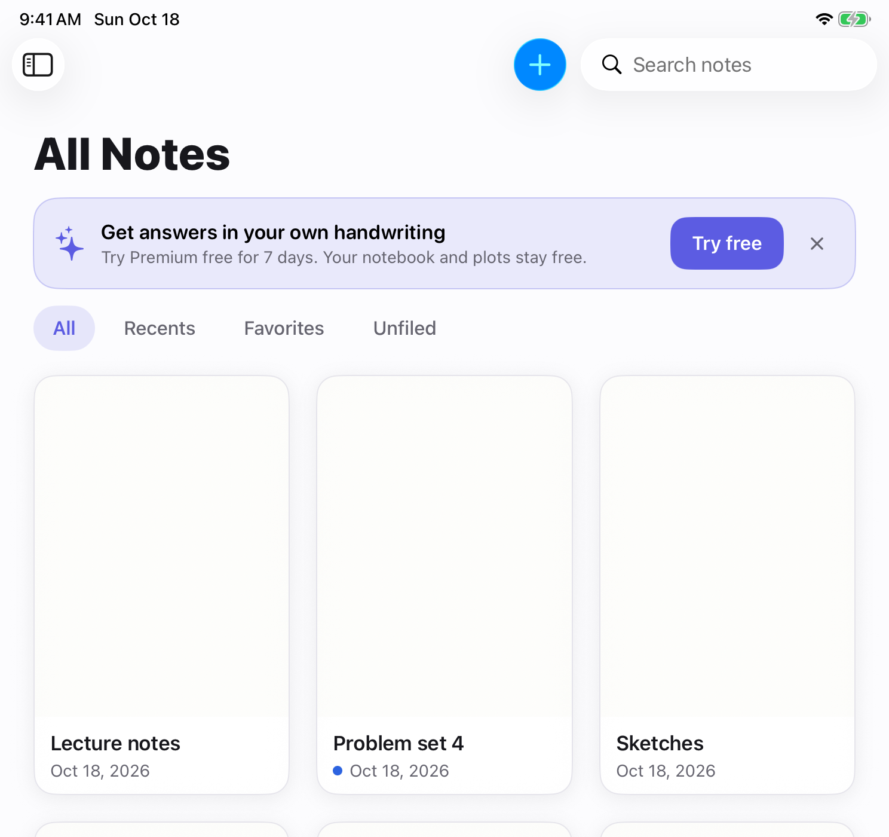</td>
<td width="33%">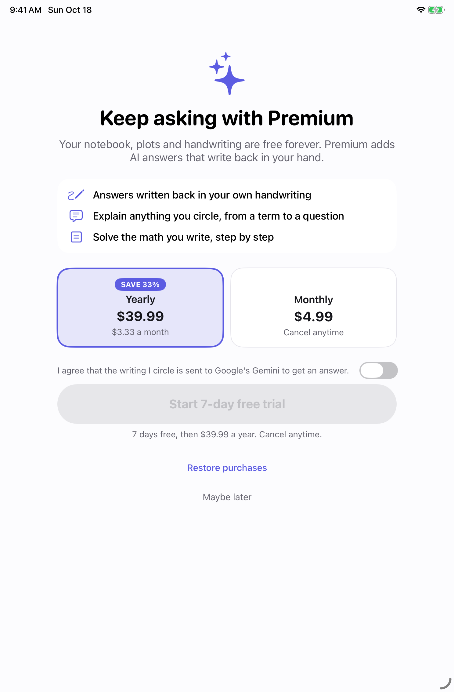</td>
<td width="33%">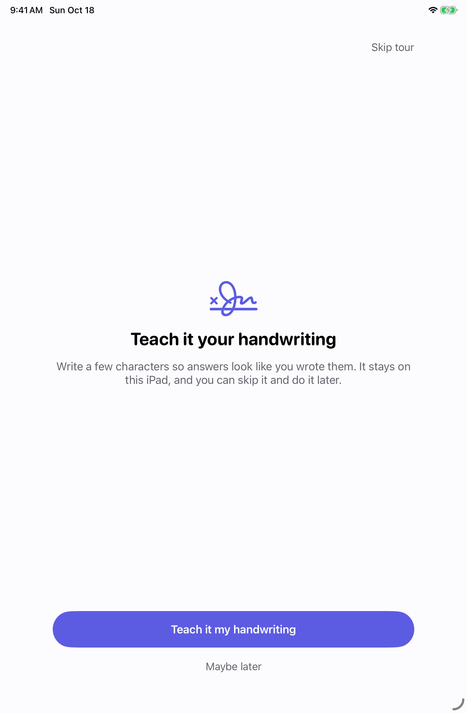</td>
</tr>
<tr>
<td align="center"><sub><b>Library</b>: folders, favourites, recents</sub></td>
<td align="center"><sub><b>Premium</b>: StoreKit 2, plans, AI consent</sub></td>
<td align="center"><sub><b>Onboarding</b>: teach it your handwriting</sub></td>
</tr>
</table>

### A board you can put anywhere

<table>
<tr>
<td width="33%">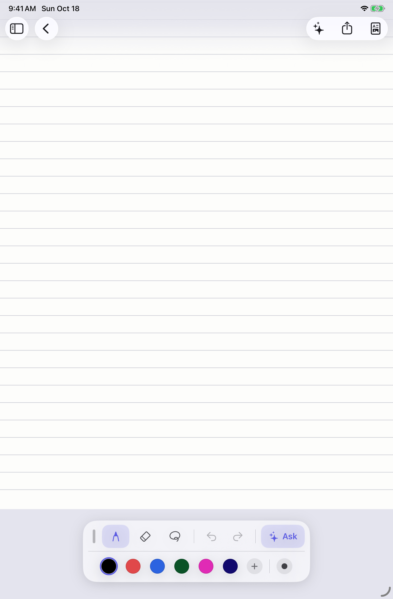</td>
<td width="33%">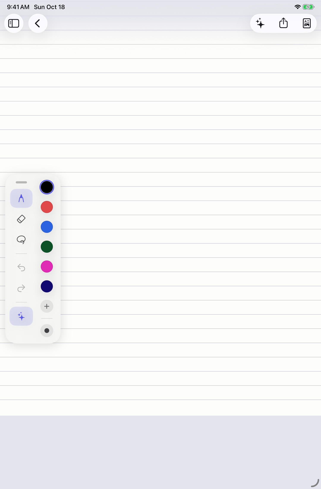</td>
<td width="33%">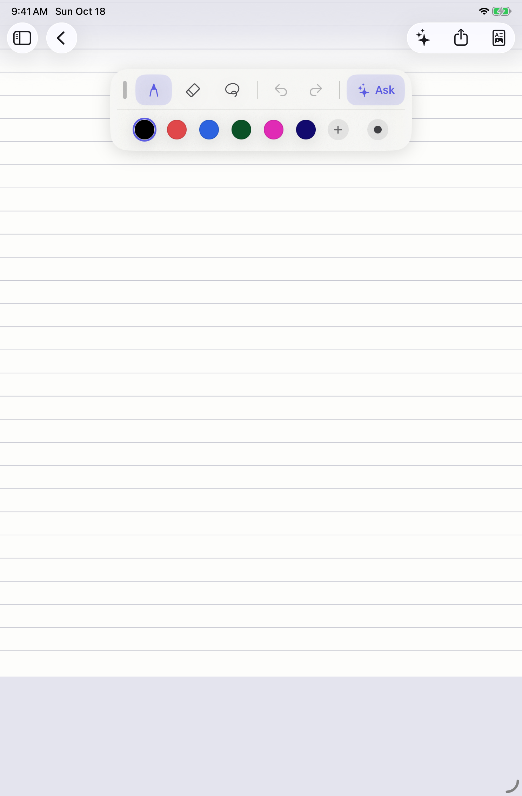</td>
</tr>
<tr>
<td align="center"><sub>Bottom</sub></td>
<td align="center"><sub>Left (stands up)</sub></td>
<td align="center"><sub>Top</sub></td>
</tr>
</table>

---

## 🧠 How it works

### One question, end to end

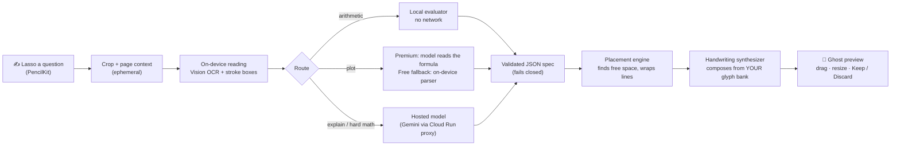

The model never draws. It returns a small, strictly validated **JSON spec** (inline text, lines, a plot block…). Everything that touches ink (where it goes, how big it is, what the letters look like) is deterministic code on the device.

### The pieces

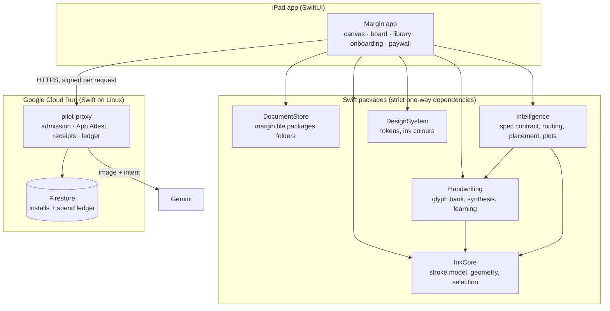

### Making ink that looks like yours

1. **Calibration** collects each character from guided boxes; a segmenter assigns strokes to characters.
2. **Learning as you write.** Lassoed ink is read with Vision's per-character boxes; strokes are matched to characters with a chamfer-distance classifier and added to the bank (capped at ~20 variants per character, duplicates rejected, generated ink never learned).
3. **Synthesis** lays glyphs out on a baseline with the writer's measured slant, spacing and size, picks variants randomly per answer, and matches the **pen width and pressure** of the question so the answer doesn't look pasted in.
4. **Missing characters** fall back per character (not per answer), so most of a sentence stays in your hand.
5. **Powers** like `x²` are drawn as a smaller, raised exponent on one shared baseline, never as a caret.

### Trust, payments and abuse protection

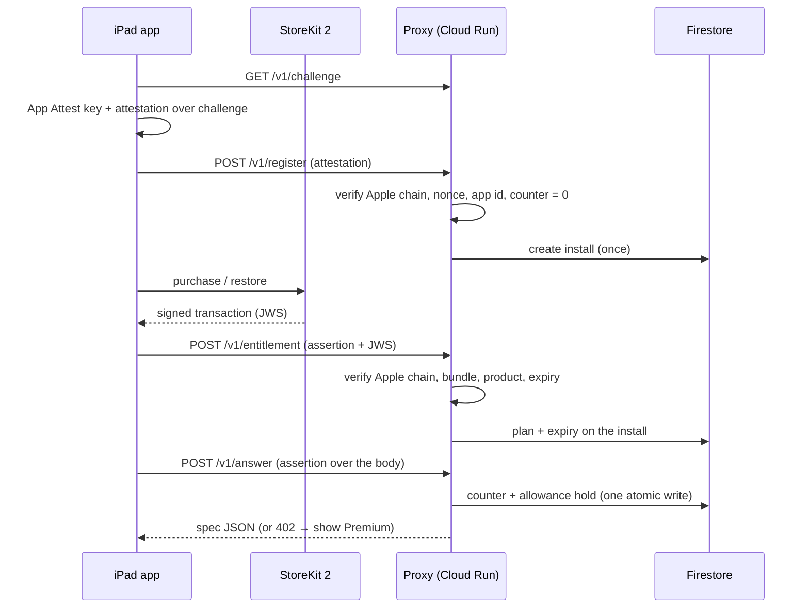

- A leaked build can't leak a credential: each install proves itself with **App Attest** and signs every request body; replays fail on a monotonic counter.
- Purchases are verified **server-side** against Apple's pinned root certificate, with no trust in the device.
- Free installs get a small server-enforced allowance; paid installs a monthly cost cap, held at the worst case and settled to the real cost.

---

## 🛠 Engineering at a glance

| | |
|---|---|
| **Codebase** | ~40,000 lines of Swift in 289 files: an app, 6 local packages, and a server |
| **Tests** | **960+** automated tests (app 300+, Intelligence 260, Handwriting 175, proxy 150, InkCore, DocumentStore, DesignSystem) |
| **Process** | 200+ pull requests, 400+ commits, 29 written architecture decision records, CI on every PR (build, tests, strict lint, formatter, colour-token and dependency-rule checks) |
| **Server** | A dependency-light Swift HTTP service on Cloud Run: hand-rolled admission and PNG validation, Firestore compare-and-set ledgers, App Attest and StoreKit receipt verification with `swift-crypto` and `swift-certificates` |
| **Privacy by construction** | Glyph banks and notebooks are never uploaded (a repository script guards the glyph bank), crops are ephemeral and never logged, third-party AI use is disclosed and consented, errors are content-free |

**Things I'm proud of**

- 🔒 **Fail-closed AI contract.** The model's reply is untrusted input: schema-constrained, decoded leniently, then validated against hard limits. Anything unsafe to render is refused, and a bad reply degrades to a friendly message, never a broken page.
- 🧪 **Testing what you can't run.** App Attest and StoreKit can't run in CI, so every seam has a fake, and the server verifiers are tested against synthesized certificate authorities that mimic Apple's chain, including forged, expired and tampered cases.
- ♻️ **Concurrency done properly.** Actors for the install session and stores, atomic Firestore commits with preconditions, idempotent holds, and tests that fire concurrent requests to prove only one wins.
- ✍️ **A handwriting engine built from first principles.** Glyph harvesting, a stroke classifier, baseline-aware layout, pen matching, and an eraser that understands lines of generated text.
- 🎛 **Details that make it feel native.** Pencil double-tap, snapping tool board, resize grips, dim-not-vanish undo, a tour that watches real actions, spring-animated docking.

**Bugs worth telling stories about**

- *The notebook was 24 pt wider than the screen.* A fixed 768 pt page was sizing the whole view, clipping 12 pt of every page. Found with Simulator screenshots from a debug launch flag; fixed by sizing the scroll content independently and scaling the page to fit.
- *The exponent sat on the line.* Each synthesized piece found its own baseline from its own descenders. Fixed with one baseline per row.
- *Vision read `x^3` as `x^13` and `cos` as `(US`.* Handled with a narrow repair layer, a formula editor, and finally by letting the model read the handwriting for Premium users.

---

## 🧰 Tech stack

| Area | Technology |
|---|---|
| App | Swift 6.2, SwiftUI, PencilKit, UIKit interop, Vision, StoreKit 2, DeviceCheck (App Attest), OSLog |
| Project | Tuist, local Swift packages, SwiftLint + swift-format, GitHub Actions |
| Server | Swift on Linux (static build), Cloud Run, Firestore REST, Secret Manager, swift-crypto, swift-certificates |
| AI | Gemini (hosted), schema-constrained JSON, plus fully local arithmetic and plotting |
| Testing | XCTest (unit, async, concurrency), synthesized PKI fixtures, Simulator screenshot staging |

---

## 🗂 Repository map

```
Apps/Margin/            The iPad app: canvas, tool board, Ask UI, library, onboarding, paywall
Packages/
  InkCore/              Stroke model, geometry, selection, page layout
  DocumentStore/        .margin file packages, folders, templates, export
  Handwriting/          Glyph bank, synthesis, learning, typeset fallback
  Intelligence/         Spec contract + validator, routing, placement, plot engine, providers
  DesignSystem/         Colours, typography, ink palette
  Analytics/            Content-free event types
Tools/pilot-proxy/      The Cloud Run server (admission, App Attest, receipts, ledgers)
scripts/                Lint, test, privacy and dependency gates, deploy
docs/media/             README media
*.md                    Plans, ADRs, pipeline and handwriting design notes
```

---

## 🚀 Build and run

Requirements: Xcode 26, [Tuist](https://tuist.dev), an iPad (or iPad simulator) on iPadOS 26.

```bash
./scripts/bootstrap.sh        # installs tooling
./scripts/generate.sh         # generates the Xcode project with Tuist
open Margin.xcworkspace       # run the "Margin" scheme on an iPad
```

```bash
./scripts/test.sh                                   # package + app tests
swift test --package-path Packages/Handwriting      # one package
swift test --package-path Tools/pilot-proxy         # the server (builds on macOS and Linux)
./scripts/lint.sh                                   # strict SwiftLint + format check
```

On a real iPad with a free Apple ID, `export TUIST_DEVELOPMENT_TEAM=<your team>` before generating. Hosted answers need a deployed proxy and credentials, which are never stored in the repo; without them, the app runs fully offline (notebook, local arithmetic and plots).

<details>
<summary><b>Staging screenshots without tapping (debug builds)</b></summary>

Debug builds accept launch arguments that stage the app for screenshots and recordings:

```bash
xcrun simctl launch booted edu.bowdoin.margin -onboarding.completedVersion 99 -margin.scenario seed
xcrun simctl launch booted edu.bowdoin.margin -margin.openNewNote 1 -board.dock leading
```

Scenarios: `seed`, `paywall`, `tour-handwriting`, `tour-disclosure`, `tour-subscribe`.

</details>

---

## 🗺 Status and roadmap

**Working today**

- [x] Notebook: Pencil canvas, lasso, eraser, undo/redo, colours and widths, templates and paper sizes, folders, favourites, export
- [x] Handwriting: calibration, continuous learning, synthesis with pen matching, ghost answers with drag and resize
- [x] Solve, Explain and Plot, including premium AI plot reading with an on-device fallback
- [x] Guided onboarding, edge-to-edge pages, dockable tool board, light and dark appearance
- [x] StoreKit 2 subscriptions, paywall and upgrade prompts
- [x] Server-side receipt verification, App Attest, per-install allowances

**Next**

- [ ] **App Store release** (waiting on the developer programme and the first real-device attestation run)
- [ ] Check and Ask-follow-up modes
- [ ] iCloud sync and backup, PDF and image import
- [ ] Accessibility pass, mixed-size layout for richer maths, whole-notebook search

---

## 📚 Documentation

| Doc | What's in it |
|---|---|
| [`PROJECT_PLAN.md`](PROJECT_PLAN.md) | Vision, scope, milestones, risks |
| [`ARCHITECTURE.md`](ARCHITECTURE.md) | Modules, data model, performance budgets |
| [`AI_PIPELINE.md`](AI_PIPELINE.md) | Selection → context → model → JSON spec → ink |
| [`HANDWRITING.md`](HANDWRITING.md) | How the user's handwriting is synthesized |
| [`BUSINESS.md`](BUSINESS.md) | Pricing, economics, App Store compliance, privacy |
| [`PREMIUM_AND_ONBOARDING_PLAN.md`](PREMIUM_AND_ONBOARDING_PLAN.md) | Tiers, trial, onboarding, server-trust build order |
| [`DECISIONS.md`](DECISIONS.md) | Architecture decision records (including ADR-031, per-install trust) |
| [`PROGRESS.md`](PROGRESS.md) · [`SESSIONS.md`](SESSIONS.md) | The task board and the work log |

---

## 🤝 How it was built

Built over about three months as a solo project, using an AI pair-programming workflow (Claude Code) under a written operating manual, [`AGENTS.md`](AGENTS.md): a human owns every product and architecture decision, agents work in small reviewed pull requests, and the repository's invariants (privacy, fail-closed validation, dependency rules) are enforced by tests and CI scripts rather than by convention.

<details>
<summary><b>For contributors and AI agents</b></summary>

If you are an AI agent (Codex, Claude Code): read [`AGENTS.md`](AGENTS.md) first, then [`CONTEXT.md`](CONTEXT.md). Do not write code before you have read both. [`CLAUDE.md`](CLAUDE.md) adds Claude Code specifics.

</details>

---

## 📄 License

The source is published so you can **read, study and run it for noncommercial purposes** (personal study, evaluation, research, hobby use). It is licensed under the [PolyForm Strict License 1.0.0](LICENSE): you may not redistribute it, make derivative works, or use it commercially without a separate written license. Lemma Notes AI is a commercial product, so those rights are reserved. The name, logo and branding are not licensed.

For a commercial or other license, open an issue on this repository.

---

<div align="center">

**Lemma Notes AI** · the working codename in the code is *Margin* · user handwriting is sensitive personal data and is never used to train any model.

</div>
